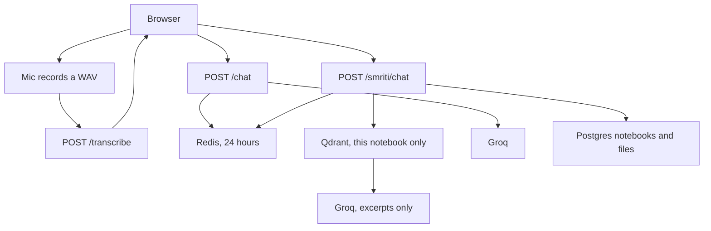

# Shruti

Shruti is a chat you can type to, or speak to in Nepali. Smriti is the notebook next to it: upload a PDF or a text file, then ask questions that have to come from those files.

The page is plain HTML, CSS, and JavaScript. The API is FastAPI. Both are served together. Replies are text. There is no text-to-speech.

Nepali audio is transcribed by a self-trained Wav2Vec2-BERT model, quantized to int8. The mic sits at the left of the message box. The transcript is shown before it is sent, so a wrong word can be corrected. The same mic works in Shruti and in Smriti.

## Two modes

You pick the mode. The app does not guess.

**Shruti** is a general assistant. It does not see uploaded files. If you ask it about a file, it points you to Smriti. Recent turns stay in Redis for 24 hours. Chats are listed on the left.

**Smriti** answers from one notebook. A notebook is a named set of files. The whole file is split, embedded, and stored in Qdrant. A question retrieves the closest pieces, and Groq answers from those pieces only. The screen names the source file. If the notebook is empty, or those pieces do not contain the answer, Smriti says so.

| | Shruti | Smriti |
|---|---|---|
| What it knows | The chat model | The files in the open notebook |
| Left rail | Your chats | Notebooks, then the chats inside the open one |
| Speech | Nepali mic, then text | Same mic, then text |

Smriti runs as a LangGraph path: retrieve, then either answer or stop. Shruti is one chat step on the same graph.



## What one Smriti answer can see

A book is not a problem to store. Every piece is a vector. A question does not send the book to the model.

- Files are split into pieces of 500 characters, with a 50-character overlap.
- The five closest pieces are sent with the question. That is about 2,500 characters of source text.
- Your message can be up to 8,000 characters. The last eight turns are included, each cut at 2,000 characters.
- Uploads are `.txt` and `.pdf`, up to 15 MB. Text files must be UTF-8. A scanned PDF with no text layer is refused.

The rest of the file stays in the index for the next question. A question whose answer sits in one passage works. A question that needs the whole book at once will often come back as not in the notebook.

Embeddings are `sentence-transformers/paraphrase-multilingual-MiniLM-L12-v2`: 384 dimensions, cosine similarity, collection `documents`. That model reads about the first 128 tokens of a piece, which is why the pieces stay near 500 characters.

## Speech model

The recognizer is Wav2Vec2-BERT, fine-tuned on the OSLR 54 Nepali speech set, then quantized from float32 to int8. The weights for this project are already quantized. You do not run `scripts/quantize.py` to start the demo. That script is for a later retrain: it loads `wandererupak/Wav2Vec2-BERT-Nepali-ASR-Finetuned-OSLR54`, quantizes the linear layers, and writes a new `quantized_model.pt`.

The API looks for `quantized_shruti_model/quantized_model.pt` in the repo root, or the path in `SHRUTI_MODEL_DIR`. The folder is gitignored, so a clone does not contain the weights. Download them once:

```bash
uv run python -c "from huggingface_hub import snapshot_download; snapshot_download(repo_id='wandererupak/shruti-quantized', local_dir='quantized_shruti_model')"
```

Without that file the API still starts. Typing and notebooks work. The mic does not, and the sidebar says the voice model is not loaded. Silence is dropped with voice activity detection before transcription.

## Data

| Store | Role |
|---|---|
| Redis | Conversation turns for 24 hours, and the lists on the left |
| Postgres | Notebooks and the files in them. Host port **5433** |
| Qdrant | Vectors for every file piece. Host port **6333** |
| Groq | The chat model. Default `openai/gpt-oss-120b`, change with `GROQ_MODEL` |

On startup the API creates the tables and the Qdrant collection. If this database still has an older reservations table, or file rows that were not part of a notebook, those rows are dropped once. Vectors that are not tied to a notebook are removed.

## Layout

```
app/
├── main.py                  # API and the page
├── agents/                  # LangGraph for chat and notebook
├── api/                     # /chat, /smriti, /transcribe, notebooks
├── db/                      # Notebook and Document
└── services/                # speech, Redis, Qdrant, retrieval
frontend/
├── index.html
└── static/                  # styles.css, app.js
docker-compose.yml           # Postgres, Redis, Qdrant
```

## Run it

You need Python 3.11+, [uv](https://docs.astral.sh/uv/), Docker, and a [Groq API key](https://console.groq.com).

```bash
cp .env.example .env
```

Set `GROQ_API_KEY`. The database, Redis, and Qdrant values in `.env.example` already match `docker-compose.yml`. `.env` is gitignored.

From the repo root:

```bash
docker compose up -d
uv sync
uv run uvicorn app.main:app --host 127.0.0.1 --port 8000
```

Open **http://127.0.0.1:8000**. API docs are **http://127.0.0.1:8000/docs**. Health is **http://127.0.0.1:8000/health**. When the speech weights are loaded, the sidebar reads “Ready · Nepali voice ready.”

```bash
curl -X POST http://127.0.0.1:8000/chat \
  -H "Content-Type: application/json" \
  -d '{"session_id":"shruti-demo","message":"What is a notebook in this app?"}'
```

```bash
curl -X POST http://127.0.0.1:8000/notebooks \
  -H "Content-Type: application/json" \
  -d '{"title":"Demo notes"}'
```

```bash
curl -X POST http://127.0.0.1:8000/notebooks/1/documents \
  -F "file=@notes.txt"
```

```bash
curl -X POST http://127.0.0.1:8000/smriti/chat \
  -H "Content-Type: application/json" \
  -d '{"notebook_id":1,"session_id":"smriti-1-demo","message":"What does the file say?"}'
```

Checks that do not need the servers or a Groq call:

```bash
uv run python -m unittest tests.test_context tests.test_replies tests.test_validation
```

`Dockerfile` builds the API, the page, and the quantized speech model. Postgres, Redis, and Qdrant stay in `docker-compose.yml`.

Spoken replies are later. They belong on Shruti, the chat, not on the notebook.
