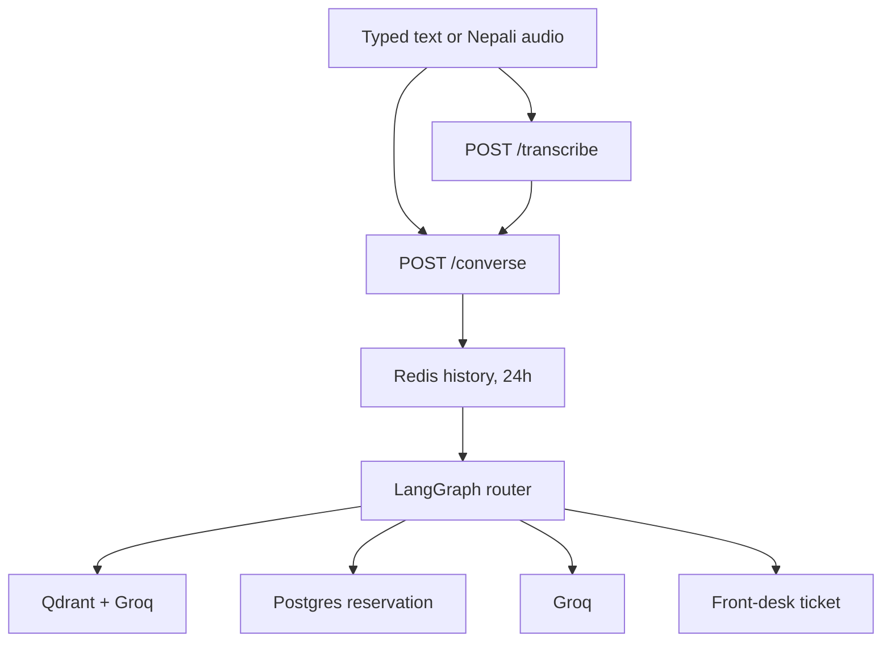

# Shruti

Shruti is a hotel concierge. A guest types in English or Nepali, or speaks Nepali. The reply is text. The property it knows is whatever you put in `knowledge_base/`. The notes in this repo are a sample, so the demo has rooms, rates, and a booking flow to show.

The screen is Streamlit. The API is FastAPI. Nepali audio is transcribed by a self-trained Wav2Vec2-BERT model that has been quantized to int8. There is no text-to-speech.

## What a guest can do

- Ask about rooms, rates, meals, the pool, airport pickup, and house rules. Answers come from `knowledge_base/`.
- Hold a room. Shruti collects name, email, check-in, check-out, guests, and room type across turns, then saves the stay in Postgres.
- Ask something that is not about the resort.
- Raise a refund, a billing problem, or a safety issue. Shruti writes a front-desk ticket to the API log and says a person has it.

**Speak Nepali** sits beside the message box. The transcript is shown first, so a wrong word can be corrected before it is sent. The sidebar lists past conversations and the rooms currently held.

## Routing

Each message enters a LangGraph router. The route is chosen from the latest message. A few recent turns are included so a booking that is still missing a detail stays on the booking path.

| Route | When | What happens |
|---|---|---|
| `rag` | Rates, hours, dining, location, house rules | Matching notes from Qdrant, then Groq, using only that text |
| `booking` | A stay, dates to check, or the next detail of a stay in progress | Fields are extracted, inventory is checked, the row is saved |
| `general` | Not about the property in the notes | Groq, with the Redis history in the prompt |
| `escalate` | Refund, overcharge, injury, theft, a manager | A ticket is written to the API log |

If retrieval finds nothing, the turn goes to the front desk instead of an invented answer.



## Speech model

The recognizer is Wav2Vec2-BERT, fine-tuned on the OSLR 54 Nepali speech set, then quantized from float32 to int8. The weights shipped for this project are already quantized. You do not run `scripts/quantize.py` to start the demo. That script is for a later retrain: it loads `wandererupak/Wav2Vec2-BERT-Nepali-ASR-Finetuned-OSLR54`, quantizes the linear layers, and writes a new `quantized_model.pt`.

The API looks for `quantized_shruti_model/quantized_model.pt` in the repo root, or the path in `SHRUTI_MODEL_DIR`. The folder is gitignored, so a clone does not contain the weights. Download them once:

```bash
uv run python -c "from huggingface_hub import snapshot_download; snapshot_download(repo_id='wandererupak/shruti-quantized', local_dir='quantized_shruti_model')"
```

Without that file the API still starts. Typing, booking, and retrieval work. `POST /transcribe` does not, and the sidebar says the voice model is not loaded.

`frontend/experimental/streaming_asr.py` is a separate streaming microphone page. It is not part of the concierge screen.

## Data

| Store | Role |
|---|---|
| Redis | Conversation turns for 24 hours, and the list in the sidebar |
| Postgres | Reservations and document rows. Host port **5433** |
| Qdrant | Note and upload vectors. 384 dimensions, cosine similarity, collection `documents` |
| Groq | The chat model. Default `openai/gpt-oss-120b`, change with `GROQ_MODEL` |

Embeddings are `sentence-transformers/paraphrase-multilingual-MiniLM-L12-v2`. The same model is used for the resort notes and for later uploads. Uploads accept `.txt` and `.pdf`, chunked `fixed` or `recursive`.

On startup the API creates the tables, creates the Qdrant collection if needed, and indexes `knowledge_base/*.txt` when those vectors are not already there. The sample notes cover rooms, rates, policies, amenities, dining, and how to reach the property.

## Booking

A stay needs a name, email, check-in, check-out, guest count, and room type: `standard`, `deluxe`, or `suite`. Dates are `YYYY-MM-DD`. Check-out is after check-in.

Inventory is 8 standard, 5 deluxe, and 2 suite. Overlapping dates for the same room type use up a room. The same email cannot hold the same dates twice. A standard room holds 2 guests, a deluxe 3, a suite 4.

The nightly deluxe rate is NPR 9,800 before tax. Nights are check-out minus check-in, so 21 November to 26 November is 5 nights and NPR 49,000 before the 13 percent VAT. The full rate card is `knowledge_base/rates.txt`.

Payment is at the front desk. The chat confirms a hold. It does not take a card.

## Layout

```
app/
├── main.py                  # API entry, seeds the notes, loads the speech model
├── agents/                  # router and LangGraph
├── api/                     # /transcribe, /converse, /chat, /documents/upload
├── db/                      # Document and Reservation
├── services/                # speech, Redis, Qdrant, booking, retrieval
└── core/settings.py
frontend/ui.py               # Streamlit concierge
knowledge_base/              # resort notes
docker-compose.yml           # Postgres, Redis, Qdrant
```

## Run it

You need Python 3.11+, [uv](https://docs.astral.sh/uv/), Docker, and a [Groq API key](https://console.groq.com).

```bash
cp .env.example .env
```

Set `GROQ_API_KEY`. The database, Redis, and Qdrant values in `.env.example` already match `docker-compose.yml`. `.env` is gitignored.

Two terminals, both from the repo root:

```bash
docker compose up -d
uv sync
uv run uvicorn app.main:app --host 127.0.0.1 --port 8000
```

```bash
uv run streamlit run frontend/ui.py
```

The page is **http://127.0.0.1:8501**. That is Streamlit’s own default port. API docs are **http://127.0.0.1:8000/docs**. The page calls `http://127.0.0.1:8000` unless `SHRUTI_API_URL` is set. When the API and the speech weights are up, the sidebar reads “Desk open · Nepali voice ready.”

```bash
curl -X POST http://127.0.0.1:8000/converse \
  -H "Content-Type: application/json" \
  -d '{"thread_id":"demo","transcript":"What time is check-in?"}'
```

```bash
curl -X POST http://127.0.0.1:8000/converse \
  -H "Content-Type: application/json" \
  -d '{"thread_id":"demo","transcript":"Book a deluxe room for Sita Sharma, sita@example.com, check-in 2026-12-12, check-out 2026-12-15, 2 guests."}'
```

`GET /reservations` lists holds. `POST /chat` is the same conversation, with `session_id` and `message` instead of `thread_id` and `transcript`.

```bash
curl -X POST http://127.0.0.1:8000/documents/upload \
  -F "file=@notes.txt" \
  -F "chunking_strategy=recursive"
```

To re-index only the files in `knowledge_base/`:

```bash
uv run python scripts/ingest_knowledge_base.py
```

Date and room rules, with no servers and no Groq call:

```bash
uv run python -m unittest tests/test_booking_rules.py
```

`Dockerfile` builds the API and downloads the quantized speech model during the image build. Postgres, Redis, and Qdrant stay in `docker-compose.yml`.

