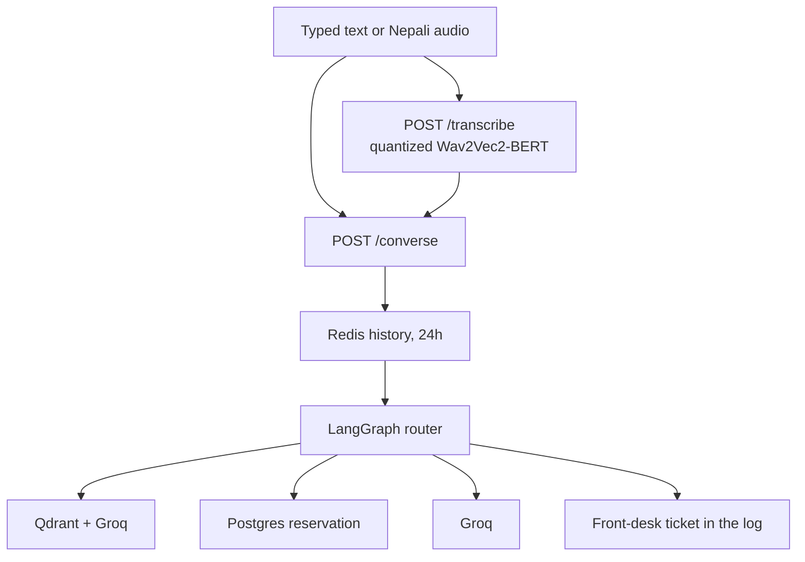

# Shruti

Shruti is the concierge for **Himalaya House**, a small resort in Lakeside, Pokhara. A guest can type in English or Nepali, or speak Nepali. The reply is always text.

This repo used to be an eSewa support bot: three routes (knowledge base, general chat, human escalation), a quantized Nepali speech model, and a Streamlit chat. The retrieval and booking stack from the Palm-RAG project now lives here too. Chroma and the SQLite conversation log are gone. The resort replaced the KYC knowledge base. Palm-RAG itself was not modified.

## What a guest can do

- Ask about rooms, rates, meals, the pool, airport pickup, and house rules. Those answers come from the notes in `knowledge_base/`.
- Hold a room. The bot collects name, email, check-in, check-out, guests, and room type across turns, then writes the stay to Postgres.
- Ask something unrelated to the resort and get a normal answer.
- Raise a refund, a billing dispute, or a safety issue. Shruti logs a front-desk ticket and says a person has it. It does not send email.
- Record Nepali. **Speak Nepali**, next to the message box, opens the recorder. The transcript is shown so it can be corrected before it is sent. There is no text-to-speech, so the answer does not wait on a second model.

The sidebar lists past conversations and the stays currently held at the desk.

## How a message is routed

LangGraph starts at a router. The decision uses the latest guest message, with a short look at recent turns so a half-finished booking stays on the booking path. A later question in the same chat is not treated as another booking.

| Route | When | What happens |
|---|---|---|
| `rag` | Rates, hours, dining, location, house rules | Top chunks from Qdrant, then Groq, grounded in that text |
| `booking` | A stay, a date-specific availability question, or the next detail of a stay already in progress | Fields are extracted, inventory is checked, the row is saved |
| `general` | Anything that is not about the house | Groq, with the Redis history in the prompt |
| `escalate` | Refund, overcharge, injury, theft, a manager | A ticket is written to the API log |

If retrieval finds nothing, the turn is escalated instead of invented.



## Speech model

The recognizer is the Wav2Vec2-BERT model fine-tuned on OSLR 54 Nepali speech, then dynamically quantized from float32 to int8. The weights that the API loads are already quantized. You do not run quantization again for this demo.

On startup the API looks for `quantized_shruti_model/quantized_model.pt` in the repo root, or the directory in `SHRUTI_MODEL_DIR`. That folder is gitignored. It is the Hugging Face repo `wandererupak/shruti-quantized` (the checkpoint plus the processor files). Download it with:

```bash
uv run python -c "from huggingface_hub import snapshot_download; snapshot_download(repo_id='wandererupak/shruti-quantized', local_dir='quantized_shruti_model')"
```

`scripts/quantize.py` is only for a future retrain. It loads `wandererupak/Wav2Vec2-BERT-Nepali-ASR-Finetuned-OSLR54`, quantizes the linear layers, and writes a new `quantized_model.pt`.

If the folder is missing, the API still starts. Text chat, booking, and retrieval work. `POST /transcribe` fails until the file is there. The sidebar then says the voice model is not loaded.

An older streaming experiment, using WebSockets and the browser microphone, is in `frontend/experimental/streaming_asr.py`. It is not part of the demo page.

## What is stored where

| Store | Role |
|---|---|
| Redis | Conversation turns, keyed by the client session id, 24 hour TTL. Also the list the sidebar uses. |
| Postgres | Document rows and reservations. Host port **5433**. |
| Qdrant | Chunk vectors, 384 dimensions, cosine. Collection name `documents`. |
| Groq | The chat model. Default `openai/gpt-oss-120b`, override with `GROQ_MODEL`. |

Embeddings are `sentence-transformers/paraphrase-multilingual-MiniLM-L12-v2`, the same model for resort notes and for files uploaded later. Upload accepts `.txt` and `.pdf`, with `fixed` or `recursive` chunking.

On startup the API creates the tables, ensures the Qdrant collection, and indexes `knowledge_base/*.txt` if those seed vectors are not already there. The notes cover rooms and rates, policies, amenities, dining, and location.

## Booking rules

Required fields: name, email, check-in, check-out, guests, room type (`standard`, `deluxe`, `suite`). Dates are `YYYY-MM-DD`. Check-out must be after check-in.

Inventory is fixed: 8 standard, 5 deluxe, 2 suite. A stay counts as overlapping when the date ranges cross. The same email cannot hold the same dates twice. Capacity is 2, 3, and 4 guests. Payment is collected at the front desk. The chat confirms a hold. It does not take a card.

## Layout

```
app/
├── main.py                  # FastAPI entry, seeds knowledge, loads ASR
├── agents/                  # state, router, LangGraph
├── api/                     # /transcribe, /converse, /chat, /documents/upload
├── db/                      # Document and Reservation
├── services/                # ASR, Redis, Qdrant, booking, RAG, escalation
└── core/settings.py
frontend/ui.py               # Streamlit concierge
frontend/experimental/       # old streaming ASR page, not in the sidebar
knowledge_base/              # resort notes
docker-compose.yml           # Postgres, Redis, Qdrant
scripts/quantize.py          # only if the full model is retrained
scripts/ingest_knowledge_base.py
```

## Run it locally

Python 3.11+, [uv](https://docs.astral.sh/uv/), Docker, and a [Groq API key](https://console.groq.com).

```bash
cp .env.example .env
```

The only value you need to change is `GROQ_API_KEY`. The database, Redis, and Qdrant lines already match `docker-compose.yml`. A file with just the key is enough. `.env` is gitignored.

```bash
docker compose up -d
uv sync
uv run uvicorn app.main:app --host 127.0.0.1 --port 8000
```

In another terminal, from the repo root:

```bash
uv run streamlit run frontend/ui.py --server.port 8501
```

Open **http://127.0.0.1:8501**. API docs are at **http://127.0.0.1:8000/docs**. The UI calls `http://127.0.0.1:8000` unless `SHRUTI_API_URL` is set. The sidebar should say “Desk open · Nepali voice ready” once both processes and the speech weights are up.

### Calls worth trying

```bash
curl -X POST http://127.0.0.1:8000/converse \
  -H "Content-Type: application/json" \
  -d '{"thread_id":"demo","transcript":"What time is check-in?"}'
```

```bash
curl -X POST http://127.0.0.1:8000/converse \
  -H "Content-Type: application/json" \
  -d '{"thread_id":"demo","transcript":"Book a deluxe room for Sita Sharma, sita@example.com, check-in 2026-12-12, check-out 2026-12-15, 2 guests."}'
```

`GET /reservations` lists holds. `POST /chat` is the same conversation with `session_id` and `message` instead of `thread_id` and `transcript`.

Upload another document:

```bash
curl -X POST http://127.0.0.1:8000/documents/upload \
  -F "file=@notes.txt" \
  -F "chunking_strategy=recursive"
```

Rebuild only the resort notes:

```bash
uv run python scripts/ingest_knowledge_base.py
```

Booking rules that do not need the servers, and do not call Groq:

```bash
uv run python -m unittest tests/test_booking_rules.py
```

`tests/test_converse.py` calls a running API and does use Groq. It is a manual script.

## Not in this version

These are the next steps, not gaps in the demo:

- Messenger or WhatsApp. `/converse` is already session-based, so a channel adapter can call it later.
- MCP tools. The router is ordinary LangGraph nodes.
- Text-to-speech.
- LangSmith traces and a comparison across open-source models. One Groq model is configured today.
- The public Streamlit and Hugging Face URLs. Those still serve the older eSewa build.

`Dockerfile` builds the API image and downloads `wandererupak/shruti-quantized` at image build time. Postgres, Redis, and Qdrant stay in Compose. A bare `docker run` of the old image is the previous eSewa build, not this concierge.
